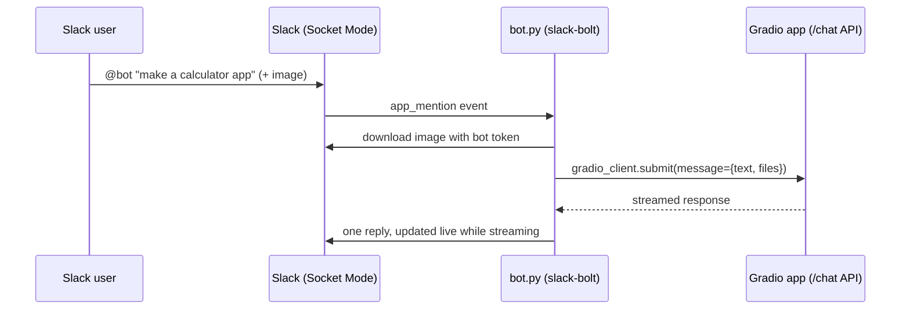

# Gradio → Slack Bot 🤖💬

A Slack bot that forwards every `@mention` (text and an optional image) to a
**Gradio app** through Gradio's built-in API and posts the app's answer back in Slack.
Built for the **AI/LLM Summer School internship at IIT Jammu** (Bots & Interfaces → *Gradio/Slack bot*),
following the official guide [Creating a Slack Bot from a Gradio App](https://www.gradio.app/guides/creating-a-slack-bot-from-a-gradio-app).

## How it works



Two Gradio back-ends are supported (switch with `GRADIO_APP` in `.env`):

| Back-end | `GRADIO_APP` | What it does |
|---|---|---|
| **Own local app – `gradio_app.py` (used)** | `http://127.0.0.1:7860/` | "Gradio Playground" clone: multimodal `gr.ChatInterface` that turns an app description into Gradio code, answered by a local Llama 3.2 (Ollama) |
| Gradio Playground Space (guide's example) | `abidlabs/gradio-playground-bot` | Same idea, hosted on Hugging Face – currently returns an error after its first message, so the local app is used instead |

## Improvements over the guide's code
- Added the imports the guide omits (`os`, `re`, `httpx`, `Client`, `handle_file`).
- Tokens loaded from `.env` instead of being hard-coded.
- Streaming answers update **one** Slack message instead of posting a new message per chunk.
- Replies go in a thread; robust parsing of string / list / dict responses; errors from the Gradio app (e.g. a failing Space) are shown in Slack.
- Ignores plain channel messages and App Home events (only `@mentions` trigger it).

## Files
| File | Purpose |
|---|---|
| `step1_test_bot.py` | Guide step 2a – minimal echo bot to test the Slack setup |
| `bot.py` | The Gradio-powered Slack bot |
| `gradio_app.py` | Optional own Gradio app (Ollama) |
| `pyproject.toml` | Dependencies: gradio, gradio_client, slack-bolt, httpx, python-dotenv |
| `.env.example` | Template for tokens and settings |
| `1_…4_*.bat`, `run_logged.ps1` | One-click Windows launchers (output also saved to `*.log`) |
| `screenshots/` | Proof of the bot working |

## Setup

### 1. Create the Slack app
1. Go to <https://api.slack.com/apps> → **Create New App** → **From scratch**, name it and pick your workspace.
2. **OAuth & Permissions → Bot Token Scopes**: add `app_mentions:read`, `chat:write`, `files:read`, `files:write`.
3. On the same page click **Install to Workspace**, then copy the **Bot User OAuth Token** (`xoxb-…`).
4. **Socket Mode** → enable it → name the token (e.g. `socket-token`) → copy the **App-Level Token** (`xapp-…`).
5. **Event Subscriptions** → enable events → **Subscribe to bot events** → add `app_mention` → Save.
6. In Slack, open a channel and run `/invite @YourBotName`.

### 2. Install and configure
```bash
uv sync --python 3.12          # or: pip install --upgrade gradio slack-bolt~=1.0 httpx python-dotenv
cp .env.example .env           # then paste SLACK_BOT_TOKEN and SLACK_APP_TOKEN
```
(Windows: double-click `1_install.bat` – it does both and opens `.env` in Notepad.)

### 3. Run
Windows: double-click **`START_BOT.bat`** – it starts the Gradio app in one window and the bot in another.

Manually:
```bash
uv run python gradio_app.py       # terminal 1: the Gradio app (http://127.0.0.1:7860)
uv run python step1_test_bot.py   # optional sanity check: echoes mentions
uv run python bot.py              # the Gradio-powered bot
```
Then in Slack: `@YourBotName create a simple calculator app` (optionally attach a UI screenshot).

**Using your own Gradio app instead:** start `uv run python gradio_app.py`
(needs Ollama with `llama3.2:3b`), open <http://127.0.0.1:7860> to try it in the browser,
set `GRADIO_APP=http://127.0.0.1:7860/` in `.env`, and restart `bot.py`.

## Screenshots
See [`screenshots/`](screenshots/): Slack app scopes, the echo test, a text request,
an image request, and (optional) the local Gradio app UI.

## What I learned
- Every Gradio app automatically exposes an API that `gradio_client` can call (`view_api()`, `submit()`, `predict()`).
- Slack apps: OAuth scopes, bot vs app-level tokens, Socket Mode (no public URL needed) and event subscriptions.
- Handling multimodal input: private Slack files must be downloaded with the bot token, then passed with `handle_file()`.
- Streaming: iterating over a Gradio `Job` yields partial outputs, which can be shown live by editing a Slack message.

---
**Author:** Anshika Rana – B.Tech CSE (AI), IGDTUW · AI/LLM Summer School, IIT Jammu
